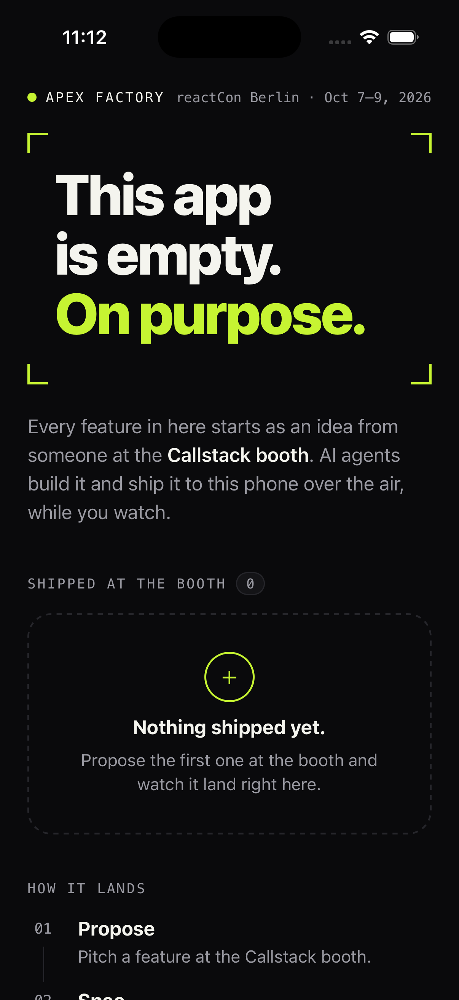
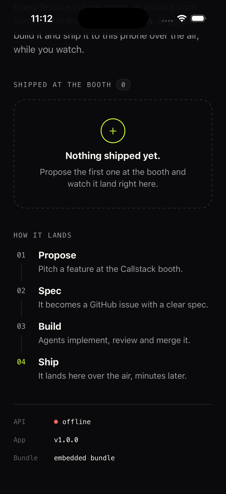
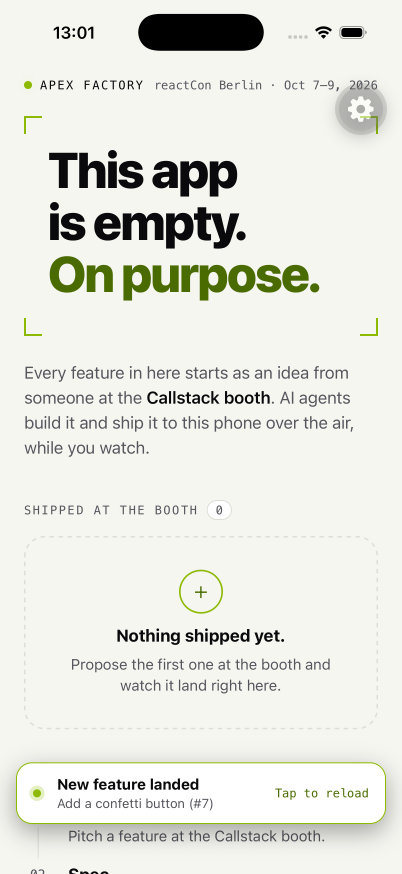
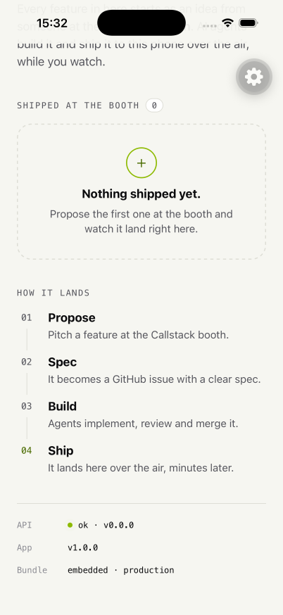
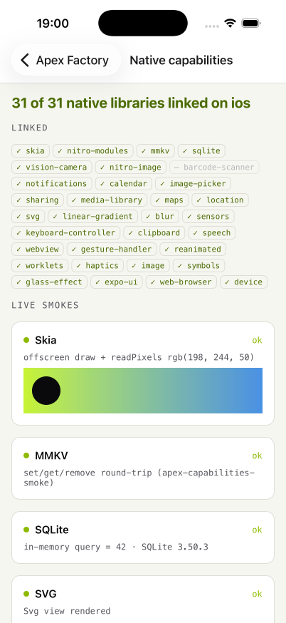

# @apex/mobile

The booth app: an Expo (SDK 57, Expo Router) app that starts out deliberately
empty. Features proposed at the Callstack booth at reactCon Berlin are built by
agents and land here over the air.

<p>
  
  
</p>

## Run it on a simulator

The app runs in a **development build** (`expo-dev-client`), not Expo Go: the
OTA updates (hot-updater, [ADR 0003](../../docs/internal/adr/0003-ota-through-self-hosted-hot-updater.md))
need a native build. `ios/` and `android/` are generated by `expo prebuild`
(Continuous Native Generation) and are not committed — change native behaviour
through `app.json` and config plugins.

From the repo root, after `pnpm install`:

```sh
pnpm --filter @apex/mobile ios       # prebuild, build, install on a simulator, start Metro
pnpm --filter @apex/mobile android   # same for an Android emulator
```

After the first build, only Metro is needed to iterate on JS:

```sh
pnpm --filter @apex/mobile start     # expo start --dev-client
```

Requirements: Xcode with an iOS simulator runtime and CocoaPods (iOS), or
Android Studio with an emulator (Android). If `pod install` fails with
`Unicode Normalization not appropriate for ASCII-8BIT`, export
`LANG=en_US.UTF-8` first.

To regenerate the native projects from scratch: `pnpm --filter @apex/mobile prebuild`.

## Release builds and over-the-air updates

Over-the-air updates only run in a **release** build: a debug build always
loads JS from Metro. The release binary checks the OTA server when it starts,
whenever it comes back to the foreground, and every 30 seconds. A new bundle
downloads in the background, then a banner says **New feature landed — tap to
reload** with the change's title; tapping it restarts into the new code. A
bundle also takes effect on the next cold start, banner or not. The status
footer's **Bundle** row shows what is running: `embedded · production` for the
JS inside the binary, `ota 0199b111…7777 · production` after an update.

The server address is compiled into the binary, so set it when you build:

```sh
LAN_IP=$(ipconfig getifaddr en0)    # the laptop's Wi-Fi address
export EXPO_PUBLIC_OTA_URL=http://$LAN_IP:3002/hot-updater
export EXPO_PUBLIC_API_URL=http://$LAN_IP:3001
export LANG=en_US.UTF-8             # CocoaPods needs a UTF-8 locale
```

On the iOS simulator `localhost` works too (the defaults), but then the build
only works on this Mac.

**iOS simulator** (from `apps/mobile`):

```sh
APPDUCT_ENABLED=1 pnpm exec expo run:ios --configuration Release --no-bundler
```

**Android device** — USB debugging on, `adb devices` lists it, Android Studio's
SDK installed (`ANDROID_HOME=$HOME/Library/Android/sdk`). From `apps/mobile`:

```sh
APPDUCT_ENABLED=1 pnpm exec expo run:android --variant release --no-bundler
```

The release variant is signed with the debug keystore that `expo prebuild`
generates — fine for installing at the booth, not for a store. To build the APK
without a device: `APPDUCT_ENABLED=1 pnpm exec expo prebuild --platform android`,
then `cd android && APPDUCT_ENABLED=1 ./gradlew assembleRelease`; the APK is
`android/app/build/outputs/apk/release/app-release.apk`
(`adb install -r <apk>`).

The release build allows plain HTTP to the laptop: on iOS through the
local-networking exception of App Transport Security, on Android through
cleartext traffic. iOS asks once to "find devices on your local network" —
allow it, or no update arrives.

### What can ship over the air

Only JavaScript and assets. Each binary carries a fingerprint of its native
side (native modules, their versions, `app.json`, config plugins), and the
server hands a bundle only to binaries with the same fingerprint. Adding or
upgrading a package with native code, or changing `app.json`, changes the
fingerprint: deploying is refused until a new binary is built and installed.

```sh
pnpm --filter @apex/mobile ota:fingerprint   # this checkout's iOS and Android fingerprints
```

`fingerprint.json` holds the fingerprints of the binaries in use; building a
binary (`expo prebuild` / `expo run:*`) rewrites it. Run `pnpm format`, commit
it together with the native change and install the new binary on every booth
phone.

An update replaces the binary's JavaScript, including the inlined
`EXPO_PUBLIC_*` addresses — so every deploy must use the same
`EXPO_PUBLIC_OTA_URL` and `EXPO_PUBLIC_API_URL` the installed binary was built
with (the deploy refuses to run without them).

## Agent tooling

Agents drive the app with three Callstack tools, all pinned in the workspace
(run them with `pnpm exec`, never `npx`). Host setup and recovery for the
laptop: [docs/internal/DEVICES.md](../../docs/internal/DEVICES.md).

| Tool                                                         | Version                    | What for                                                                                     | Where it runs                                             |
| ------------------------------------------------------------ | -------------------------- | -------------------------------------------------------------------------------------------- | --------------------------------------------------------- |
| [agent-device](https://oss.callstack.com/agent-device/docs/) | 0.21.20 (root)             | every interaction with a simulator: open, snapshot, press, screenshot, replay `e2e/*.ad`     | host only, nothing in the app                             |
| [appduct](https://incubator.callstack.com/appduct/)          | 0.14.0 (root CLI, app SDK) | shortcuts: read app state, jump to a screen, run an OTA check now, emulate the update banner | in every build, the booth binary and OTA bundles included |
| [Rozenite](https://www.rozenite.dev)                         | 2.4.0 (app devDependency)  | debugging: network, console, React tree, performance, plus the same tools                    | debug builds with Metro started by `start:agent`          |

<p>
  
  
</p>

### One build profile: `APPDUCT_ENABLED=1`

appduct has native code. `APPDUCT_ENABLED=1` links it into Release as well as
Debug, and it changes the native fingerprint, so the booth binary, every
fingerprint check and every OTA deploy use it. The package scripts (`ios`,
`android`, `prebuild`, `export:check`, `ota:*`, `start:agent`) set it, and
`hot-updater.config.ts` refuses to load without it, so a prebuild or deploy
that forgot it fails instead of describing a binary no phone has. Run native
builds through the scripts, or prefix `expo run:*` and `./gradlew` with
`APPDUCT_ENABLED=1`. Check a built app with
`pnpm exec appduct doctor <path/to/App.app|app.apk> --assert-present`.

### Dev loop (debug build + Metro)

```sh
pnpm --filter @apex/mobile ios --device <UDID> --no-bundler      # once: debug build with appduct
pnpm --filter @apex/mobile start:agent                            # Metro with Rozenite on
```

### agent-device

```sh
export AGENT_DEVICE_NO_UPDATE_NOTIFIER=1
pnpm exec agent-device open com.callstack.apexfactory --platform ios --udid <UDID>
pnpm exec agent-device snapshot -i                    # refs like @e7
pnpm exec agent-device press 'id="status-api"' --settle
pnpm exec agent-device screenshot ./shot.png
pnpm exec agent-device open com.callstack.apexfactory "apexfactory:///some/route"   # deep link
pnpm exec agent-device close
pnpm exec agent-device replay apps/mobile/e2e/home.ad --udid <UDID>   # from the repo root
```

Selectors use the `testID`s (`id="status-api"`) and labels on every key
element. `e2e/*.ad` are replay scripts; `home.ad` proves the home screen on a
debug or release build. A device is owned by one agent-device session at a
time: `close` before a `replay` on the same simulator.

### appduct

The app registers its tools at startup (`src/dev/agent-tools.ts`). Pair once
per app launch, from `apps/mobile` (the scheme comes from
`.appduct/config.json`):

```sh
pnpm exec appduct sessions link --open ios-sim --device <UDID> --json   # keep data.sessionId
pnpm exec appduct sessions ls                                           # state: active
pnpm exec appduct tools ls <session>
pnpm exec appduct tools call <session> app_info --input '{}'
pnpm exec appduct tools call <session> open_route --input '{"path":"/"}'
pnpm exec appduct tools call <session> show_update_banner --input '{"message":"Add a confetti button"}'
pnpm exec appduct events tail <session> --follow --name 'ota.*'
```

iOS asks "Open in Apex Factory?" the first time a link arrives; accept it
(`agent-device press 'label="Open"'`), or deliver the link with agent-device,
which accepts it for you: `appduct sessions link --json` without `--open`,
then `agent-device open com.callstack.apexfactory '<data.deepLink>'`. A
pairing link never navigates the app (`src/app/+native-intent.tsx`).

| Tool                                   | Does                                                                                                                              |
| -------------------------------------- | --------------------------------------------------------------------------------------------------------------------------------- |
| `app_info`                             | app version, platform, channel, bundle id (embedded or OTA), fingerprint, current route, all routes, OTA and API URLs (read-only) |
| `open_route {path}`                    | navigate to any route by path, e.g. `/features/12`; refuses a path no route matches                                               |
| `ota_check_now`                        | run the OTA check now instead of waiting up to 30 s; reports `staged`, `no_update`, … (release builds)                            |
| `show_update_banner {message?, kind?}` | show the "New feature landed" banner without a deploy; a tap dismisses it                                                         |
| `hide_update_banner`                   | hide the banner                                                                                                                   |
| `reload_app`                           | restart into the staged bundle, like tapping the banner (destructive)                                                             |
| `api_health`                           | call `/health` through the contract client, as the footer does, including the round trip in `latencyMs` (read-only)               |
| `native_capabilities`                  | every native library in the binary: `linked`, `missing` or `not-on-platform`, checked without permission prompts (read-only)      |
| event `ota.update_staged`              | posted when a real bundle has downloaded                                                                                          |

A shipped feature adds its own tools in `src/features/<id>/agent-tools.ts`
and lists them in `src/features/agent-tools.ts`; they appear under the group
`features/<id>`.

### Rozenite

With Metro from `start:agent`, from `apps/mobile`:

```sh
pnpm exec rozenite agent targets                                  # pick your device's id
pnpm exec rozenite agent session create --deviceId <id>
pnpm exec rozenite agent domains --session <id>                   # console, network, react, …, app, controls
pnpm exec rozenite agent network call --tool startRecording --session <id>
pnpm exec rozenite agent network call --tool listRequests --session <id>
pnpm exec rozenite agent console call --tool getMessages --session <id>
pnpm exec rozenite agent app call --tool app.app_info --session <id>   # the appduct tools, through Metro
```

Every app connected to that Metro shows up in `targets`, so check the name
and the data before trusting a target. An agent session takes the app's one
debugger connection, so it disconnects a person's React Native DevTools.
Release and OTA bundles contain no Rozenite code.

## Environment

| Variable                      | Default                             | Purpose                                                                                                                               |
| ----------------------------- | ----------------------------------- | ------------------------------------------------------------------------------------------------------------------------------------- |
| `EXPO_PUBLIC_API_URL`         | `http://localhost:3001`             | Origin of `apps/api`. `localhost` works on the iOS simulator; on a phone or Android emulator use the laptop's LAN IP (or `10.0.2.2`). |
| `EXPO_PUBLIC_OTA_URL`         | `http://localhost:3002/hot-updater` | The OTA server (`apps/ota-server`). Same rule: the laptop's LAN IP for a phone.                                                       |
| `GOOGLE_MAPS_ANDROID_API_KEY` | none (placeholder: empty map)       | Google Maps key for `react-native-maps` on Android, written into the manifest at prebuild. Native build input only; never committed.  |

`EXPO_PUBLIC_*` variables are inlined when the bundle is built. Put them in
`apps/mobile/.env.local` (git-ignored) or pass them on the command line. For a
release binary they must be set at native build time; changing them means a
new binary.

The API is optional: when it is not reachable the status footer shows
"offline" and the app keeps working.

## Scripts

| Script            | What it does                                                                   |
| ----------------- | ------------------------------------------------------------------------------ |
| `start`           | Metro for the dev client                                                       |
| `start:agent`     | Metro with Rozenite on (`WITH_ROZENITE=true`), for agents debugging the app    |
| `ios`             | `expo run:ios` — native build and launch                                       |
| `android`         | `expo run:android`                                                             |
| `prebuild`        | Regenerate `ios/` and `android/` from `app.json`                               |
| `typecheck`       | `tsc --noEmit`                                                                 |
| `test`            | Jest (`jest-expo` preset, React Native Testing Library)                        |
| `export:check`    | Production bundles for iOS and Android into `dist/` (smoke)                    |
| `ota:deploy`      | `hot-updater deploy`: build, upload and register an OTA bundle (CI does this)  |
| `ota:fingerprint` | Print the native fingerprints; exits non-zero if they differ from the recorded |

`pnpm check` at the root runs `typecheck` and `test` here along with lint and
format for the whole repo.

## Layout

```
src/
  app/                 routes (Expo Router) — screens only; _capabilities is a hidden dev route
  components/          UI building blocks
  dev/                 agent tools (appduct), the native capabilities probe and its screen
  features/registry.ts the list of features shipped at the booth
  lib/                 API client, OTA updates (hot-updater), root providers and hooks
  theme.ts             colour, spacing and font tokens (dark first)
plugins/               local config plugins (local-only notifications, Android maps key, Gradle heap)
```

## Shipping a feature

1. Build the feature: a route in `src/app/` if it needs a screen, components in
   `src/components/` (or `src/features/<id>/` when it has several parts).
2. Append an entry to `shippedFeatures` in
   [`src/features/registry.ts`](src/features/registry.ts) — id, title, summary,
   issue number, ship date and (optionally) the route. The home screen's
   "Shipped at the booth" list picks it up, newest first.
3. Talk to the API only through `api` from `src/lib/api.ts`; request and response
   shapes live in `@apex/contract`.
4. Prefer JS-only changes. A new native module changes the binary's fingerprint
   and cannot ship over the air (ADR 0003). The binary already carries the
   native libraries booth features are likely to need — Skia, MMKV, SQLite,
   VisionCamera (QR scanning), local notifications, calendar, image picker,
   sharing, media library, maps, location, SVG, gradient, blur, sensors,
   keyboard-controller, clipboard, speech, WebView, plus Reanimated, Gesture
   Handler, `expo-image`, `expo-haptics`, `expo-glass-effect`, `expo-symbols`
   and `@expo/ui`. The list with permissions and platform limits (Android maps
   need a key at build time; notifications are local only) is
   [docs/internal/NATIVE-CAPABILITIES.md](../../docs/internal/NATIVE-CAPABILITIES.md);
   anything not on it needs a native build. JS-only packages such as
   FlashList v2, `@gorhom/bottom-sheet` or `victory-native` can ship over the
   air — confirm with `ota:fingerprint` that the fingerprint did not change.

### Native capabilities

<p>
  
</p>

What the running binary links: the appduct tool `native_capabilities`, or the
hidden route `/_capabilities` (`open_route {"path":"/_capabilities"}`; not
linked from the home screen), which adds a live smoke per library — Skia
draws, MMKV and SQLite round-trip, SVG, gradient, blur, WebView and map views
render, sensors and permissions are read without prompting. The probe list is
`src/dev/native-capabilities.ts`; keep it in step with
`docs/internal/NATIVE-CAPABILITIES.md`.

Android maps: Google Maps needs an API key in the manifest. Build the Android
binary with `GOOGLE_MAPS_ANDROID_API_KEY=<key>` in the environment (never
commit it); without it the map shows an empty grid. iOS uses Apple Maps and
needs no key.

## Monorepo notes

- pnpm isolated `node_modules` work as-is with SDK 57; Metro needs no custom
  config (`expo/metro-config` detects the workspace root).
- `@apex/contract` ships TypeScript source with `.ts`-suffixed imports. Metro
  resolves those directly; `tsconfig.json` sets `allowImportingTsExtensions`.
- Jest uses `jest.resolver.js`, which wires Reanimated 4's worklets resolver
  in a pnpm-safe way (the upstream one also matches packages whose
  `.pnpm/` directory name merely mentions `react-native-worklets`).
