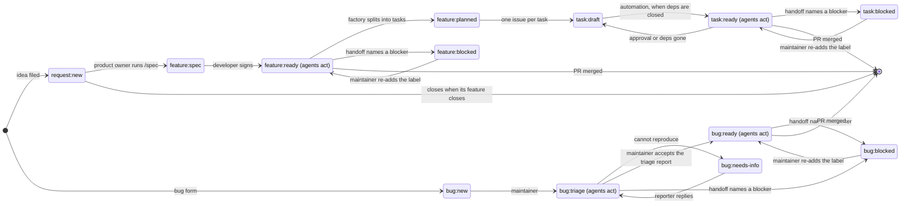
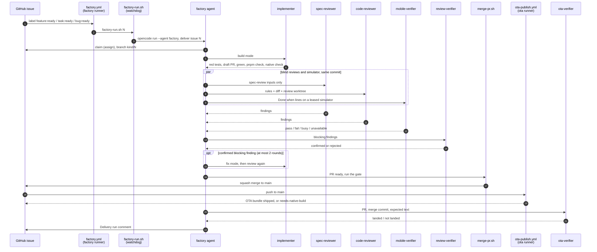
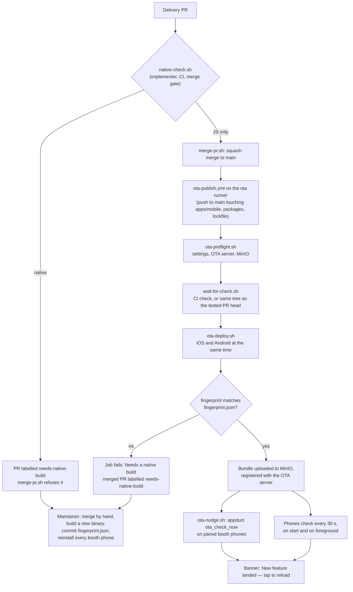

# How the factory works

Apex Software Factory turns an idea from a booth visitor into a feature on a
phone, with no person writing the code. A visitor describes the idea; it
becomes a GitHub issue. A product owner writes the product requirements, and a
developer writes the technical spec and adds the `feature:ready` label. From
there agents work alone: they implement the change tests-first, review it
twice without seeing each other's context, check it on a simulator, and merge
it. The merge to `main` publishes an over-the-air (OTA) update, and the phones
at the booth show "New feature landed — tap to reload" within a minute. Every
agent runs in [OpenCode](https://opencode.ai) on one model,
`callstack.ai/callstack/Apex`, set once in [`opencode.json`](../opencode.json).
Everything runs on one Mac at the booth: the GitHub Actions runners, the
simulators, the OTA server and its storage.

This page explains how the pieces fit. The binding rules and the detail are in
[`AGENTS.md`](../AGENTS.md) and [`docs/internal/`](internal/); this page links
to them instead of repeating them. To set up a machine, see
[BOOTSTRAP.md](BOOTSTRAP.md).

## From idea to phone

| Stage                | Who                       | How                                                     | Result                                       |
| -------------------- | ------------------------- | ------------------------------------------------------- | -------------------------------------------- |
| Idea                 | Visitor, with a facilitator | `/intent` (the `intake` agent) or the "Idea for the app" issue form | A `request:new` issue, in the visitor's words |
| Product requirements | Product owner             | `/spec <request>`                                       | A `feature:spec` issue with the business sections |
| Technical spec       | Developer                 | `/spec <n> technical`, ending with the `spec-checker`  | The Technical spec in the same issue         |
| Signature            | Developer                 | Adds `feature:ready`                                    | A factory run starts on the booth Mac        |
| Delivery             | Agents                    | `factory.yml` → `factory-run.sh` → the `factory` agent  | A merged PR                                  |
| Ship                 | GitHub Actions            | `ota-publish.yml` on the booth Mac                      | An OTA bundle on the phones                  |
| Did it land?         | Agent                     | `ota-verifier` on a simulator                           | A line in the run's `## Delivery run` comment |

A spec template pre-filled with the house defaults keeps the developer's part
short: [`docs/internal/templates/booth-feature.md`](internal/templates/booth-feature.md).
Small gaps the spec leaves open do not stop delivery. The implementer picks the
conservative option and writes it as an `Assumption:` line in the PR, and the
spec reviewer checks it.

### End to end

```mermaid
flowchart LR
    V["Visitor + facilitator<br/>/intent"] --> R["request:new issue"]
    R --> PO["Product owner<br/>/spec &lt;request&gt;"]
    PO --> FS["feature:spec issue<br/>business sections"]
    FS --> DEV["Developer<br/>/spec &lt;n&gt; technical<br/>+ spec-checker"]
    DEV --> FR["feature:ready<br/>(the signature)"]
    FR --> FY["factory.yml<br/>self-hosted factory runner"]
    FY --> AG["factory agent<br/>implement, review, verify"]
    AG --> M["merge-pr.sh<br/>squash merge to main"]
    M --> OP["ota-publish.yml<br/>self-hosted ota runner"]
    OP --> S["OTA server :3002<br/>+ MinIO :9000"]
    S --> P["Booth phones<br/>banner: New feature landed"]
    AG -.->|"native change"| NB["needs-native-build<br/>parked for a maintainer"]
```



## Issue labels

GitHub Issues are both the spec and the queue. The issue body is the spec an
agent builds against. One `<kind>:<state>` label per open issue tells agents
whether they may act. Agents act only on four labels: `feature:ready`,
`task:ready`, `bug:triage` and `bug:ready`. Only a person, or automation a
maintainer configured, moves an issue into one of them.



`feature:planned` is never picked up itself: each task gets its own run when it
turns `task:ready`. Three labels sit outside the scheme and mark pull requests
or tests: `needs-simulator` (parked: the simulator check could not run),
`needs-native-build` (parked: cannot ship over the air) and `flaky-test`.
`issue-state.yml` keeps the labels consistent (one state label, task
promotion, releasing stale claims); `labels.yml` keeps them equal to
[`.github/labels.json`](../.github/labels.json). Full table and transitions:
[DELIVERY.md, Labels](internal/DELIVERY.md#labels) and
[agent-rules/delivery.md](internal/agent-rules/delivery.md).

## One delivery run

Adding a ready label (or `bug:triage`) starts
[`.github/workflows/factory.yml`](../.github/workflows/factory.yml) on one of
the booth Mac's two self-hosted runners labelled `factory`. So two issues can
be delivered side by side. The job checks that the person who set the label
has write access, checks out the newest `main`, and runs
[`.agents/scripts/factory-run.sh`](../.agents/scripts/factory-run.sh). That
script runs `opencode run --standalone --agent factory --auto "deliver #<n>"`
(with `-m callstack.ai/callstack/Apex#low`, the agent's reasoning variant)
under a watchdog. The `factory` agent loads the `deliver` skill. It never
writes code or reads a diff: it starts subagents, each in a fresh context, and
reasons over their fixed report blocks.



What each step means, in short:

1. **Split.** A feature whose Technical spec lists tasks is split into
   `task:draft` issues and the run stops. Each task starts its own run when
   the automation promotes it to `task:ready`.
2. **Implement.** The implementer works in its own worktree under
   `.worktrees/`, commits the spec's tests red, opens a draft PR so CI runs
   from the first push, makes them green (contract → API → screen), runs
   `pnpm check` and `.agents/scripts/native-check.sh`. It never touches a
   device.
3. **Review and simulator, in parallel.** Two blind reviews and the simulator
   check start in the same message. `.agents/scripts/review-inputs.sh` builds
   each reviewer's inputs, so what a reviewer can see is decided by a script,
   not by an agent. A third fresh agent, `review-verifier`, reproduces each
   blocking finding. Nits go into one follow-up comment and never start a new
   round.
4. **Merge.** The factory writes the PR's `## Review` section, marks it ready
   and runs `.agents/scripts/merge-pr.sh`. The gate refuses a draft, a parked
   label, a missing review result, a "spec needs" line, a native diff, red CI
   or a conflict.
5. **Ship and check.** The merge starts `ota-publish.yml`. The `ota-verifier`
   then installs a Release build of `main` from before the merge on a leased
   simulator, asks the app to check for updates, taps the banner and confirms
   the new bundle and the feature on screen. A miss is a note for the
   maintainer, never a reason to park.

An agent that stops early unassigns itself and leaves one `## Handoff` comment
(Done, Not done, Findings, Blocked on). If it names a blocker, the issue moves
to `<kind>:blocked`. The walkthroughs are in
[DELIVERY.md](internal/DELIVERY.md#walkthrough-4-unattended-delivery).

## The OTA path

The mobile app uses [hot-updater](https://github.com/gronxb/hot-updater)
with a self-hosted server ([`apps/ota-server`](../apps/ota-server)) and MinIO
for storage. The strategy is **fingerprint**: a bundle reaches only binaries
whose native fingerprint matches. [`apps/mobile/fingerprint.json`](../apps/mobile/fingerprint.json)
records the fingerprint of the binary on the booth phones. A change to native
code, a native dependency, `app.json` or a config plugin changes the
fingerprint, so it cannot ship over the air.



The publish job never runs for a pull request: its runner holds the OTA token
and the S3 credentials. Phones keep the last bundle until a maintainer ships a
new binary. Detail, rollback and troubleshooting:
[OTA.md](internal/OTA.md). What the booth binary can do without a native
build: [NATIVE-CAPABILITIES.md](internal/NATIVE-CAPABILITIES.md).

## The agents

All agents live in [`.opencode/agent/`](../.opencode/agent/). Every one runs
the same model; an agent file may only pick a reasoning variant of it
([ADR 0008](internal/adr/0008-reasoning-variants-of-the-one-model.md)). The
step cap is the maximum number of agentic steps before OpenCode forces a
text answer ([ADR 0015](internal/adr/0015-step-caps-and-no-implementer-device.md)).

| Agent             | Kind     | Job                                                                                             | What it may see and do                                                                                                   | Variant | Step cap |
| ----------------- | -------- | ----------------------------------------------------------------------------------------------- | ------------------------------------------------------------------------------------------------------------------------ | ------- | -------- |
| `factory`         | primary  | Orchestrates one delivery; starts subagents, reasons over their reports, merges through the gate | Everything not denied; never writes code or reads the diff (by its skill)                                                | low     | 60       |
| `intake`          | primary  | Booth front door: turns a visitor's idea into a `request:new` issue                            | Talks and files one issue; no edits, no subagents                                                                        | default | none     |
| `implementer`     | subagent | Tests-first implementation in a worktree; fix mode for findings                                 | The repo, the issue body, defaults; never a device                                                                       | medium  | 80       |
| `spec-reviewer`   | subagent | Blind spec review: is every Scope and Done when line delivered, nothing extra                  | Only its inputs directory: issue, parent, linked ADRs and rules, `defaults.md`, `Assumption:` lines, diff. Not the repo | medium  | 20       |
| `code-reviewer`   | subagent | Blind code review: what input or state breaks each changed function; rule breaches              | All agent rules, the ADR index, the diff, a detached worktree of the PR head. No issue, PR body, commit messages, `gh` or web | medium  | 40       |
| `review-verifier` | subagent | Reproduces each blocking finding; confirms or rejects it                                        | The review worktree and the findings. No PR body, commit messages, `gh` or web                                           | low     | 30       |
| `mobile-verifier` | subagent | Proves Done when lines and `e2e:` replays on a leased iOS simulator                             | `device-lane.sh`; no edits                                                                                               | medium  | 40       |
| `ota-verifier`    | subagent | After a merge, checks the OTA update landed on a simulator                                      | `device-lane.sh`; no edits, never deploys or rolls back                                                                  | low     | 40       |
| `triager`         | subagent | Reproduces a bug as a failing test, finds the root cause, posts a report; no fix                | The repo; a leased simulator when only a running app shows the bug                                                       | medium  | 60       |
| `spec-checker`    | subagent | Checks a Technical spec before the developer signs it                                           | Read-only: the issue, rules, ADRs, native capabilities, the code                                                         | medium  | 25       |
| `build`           | primary  | OpenCode's default agent, for people                                                            | The only agent allowed the `agent-device` and `appduct` MCP tools                                                        | default | none     |

"Default" is the model's own setting in `opencode.json` (`reasoningEffort:
medium`). Subagents never start subagents, and no agent can ask a question:
a subagent's question would wait forever. The `triager` is a subagent, but
`factory-run.sh --triage <n>` also runs it as the top agent for a
`bug:triage` label. Why one model changes how reviews work:
[DELIVERY.md, Why one model changes the review](internal/DELIVERY.md#why-one-model-changes-the-review).

## Callstack's device tools

The factory is also a showcase for Callstack's tools for agentic React Native
work. Agents reach devices only through
[`.agents/scripts/device-lane.sh`](../.agents/scripts/device-lane.sh): one
worktree, one lease, one agent-device session. The script never calls raw
`simctl` or `adb`.

| Tool                                                           | What it does here                                                                                                                                                         | Used by                                                                                        |
| -------------------------------------------------------------- | ------------------------------------------------------------------------------------------------------------------------------------------------------------------------- | ---------------------------------------------------------------------------------------------- |
| [simlock](https://github.com/callstackincubator/simlock)       | Leases booted, exclusive simulators and emulators, with a queue and a TTL. Its devices live in a private device set no other tool touches.                                 | `mobile-verifier`, `ota-verifier`, `triager`, `prewarm.sh`. Never the implementer.              |
| agent-device                                                   | Every interaction with a device: accessibility snapshots, taps, waits, screenshots, and `.ad` replay scripts (`apps/mobile/e2e/<name>.ad`, a spec's `e2e:` tests).         | The same lanes; the `build` agent through MCP, for people.                                     |
| appduct                                                        | Tools the running app registers (`app_info`, `open_route`, `ota_check_now`, `native_capabilities`, a feature's own shortcuts), called from the Mac. It is in the booth binary and every OTA bundle (`APPDUCT_ENABLED=1`). | `mobile-verifier` (the spec's Agent hooks), `ota-verifier` (`ota_check_now`), `triager`, `scripts/ci/ota-nudge.sh` after a deploy. |
| Rozenite                                                       | React Native DevTools data for agents, through Metro. Debug builds only (`WITH_ROZENITE=true`); never in a Release build or an OTA bundle.                                 | `mobile-verifier` for evidence on a failure, `triager`.                                        |

Host setup and recovery: [DEVICES.md](internal/DEVICES.md). The decision:
[ADR 0007](internal/adr/0007-device-lane-simlock-agent-device.md). How an
agent uses each tool: [apps/mobile/README.md, Agent tooling](../apps/mobile/README.md#agent-tooling).

## What keeps it fast

- **Native build cache.** A simulator build is cached by platform, profile and
  OTA fingerprint in `~/.cache/apex-software-factory/native/`. Most booth PRs
  change only JavaScript, so the lane copies the cached binary and swaps in the
  PR's JS bundle instead of compiling. On the temporary dev Mac a full Release
  build took 244 s; a JS-only change built in 15–17 s. A lane binary takes no
  OTA update, so it always runs the PR's JS.
  ([ADR 0010](internal/adr/0010-native-build-cache.md),
  [`tools/expo-build-cache/`](../tools/expo-build-cache/))
- **Cheap worktrees.** `.agents/scripts/worktree.sh` clones the main
  checkout's `node_modules` with APFS `clonefile` (no data copied), then runs
  `pnpm install --offline`, which only relinks.
- **Parallel work.** The two reviews and the simulator check run at the same
  time on the same commit. Two `factory` runners deliver two issues side by
  side; simlock queues device leases, and a build slot keeps two Xcode builds
  apart.
- **Lean reviews.** A reviewer proves a claim with the affected test file only,
  at most three break-and-rerun probes, and never runs the full `pnpm check`
  (CI does). Only confirmed blocking findings start another round, and there
  are at most two rounds. ([ADR 0009](internal/adr/0009-a-faster-delivery-loop.md))
- **Reasoning carried between steps.** `opencode.json` sends the model's
  earlier reasoning back in the field the endpoint reads (`reasoning`), so the
  model does not plan from scratch at every step.
  ([ADR 0014](internal/adr/0014-keep-the-models-reasoning-between-steps.md))
- **Step caps and variants.** Each agent has a hard step cap and a reasoning
  variant that fits its job (low for the orchestrator and verifiers, medium for
  the rest). ([ADR 0008](internal/adr/0008-reasoning-variants-of-the-one-model.md),
  [ADR 0015](internal/adr/0015-step-caps-and-no-implementer-device.md))
- **A quicker OTA path.** The publish skips waiting for a second CI run when
  the merge commit's tree equals the tested PR head's tree. iOS and Android
  deploy at the same time, and paired phones are nudged to check at once.
- **Retries on endpoint faults.** `factory-run.sh` restarts a run once when
  it stalls, times out or its turn ends on a provider error (after a 60 s
  pause). The `deliver` skill runs a subagent up to three times when it returns
  no report block (a dropped stream or a 503).
- **Morning warm-up.** `.agents/scripts/prewarm.sh` fills the pnpm store and
  the native build cache, and boots simlock's simulators before the first
  visitor.

## Safety rails

- **Allow by default, with a short deny list.** Nothing asks for permission,
  because an unanswered question hangs a run. `opencode.json` denies, for every
  agent: `gh pr merge`, force pushes and pushes to `main`, skipping hooks
  (`--no-verify`, `LEFTHOOK=0`), OTA deploys and rollbacks, reading or editing
  `.env` files, and simlock's, agent-device's and appduct's operator commands.
  Reviewers keep their blind-review limits in their own agent files.
  `.agents/scripts/check-agent-permissions.sh` fails if any agent can reach
  "ask". ([ADR 0012](internal/adr/0012-allow-by-default-watchdog-dispatcher.md))
- **One merge path.** Agents merge only through `.agents/scripts/merge-pr.sh`.
  CI's `check` job is the required check the gate waits for.
- **Only CI deploys, and only from `main`.** `ota-publish.yml` has no
  `pull_request` trigger and must never get one; a dispatch from another
  branch runs the preflight only. No agent deploys, rolls back or disables a
  bundle.
- **Secrets stay in `.env` files agents cannot read.** The OTA token and S3
  credentials live in `infra/.env`, `apps/ota-server/.env` and the repo's
  Actions secrets.
- **The dispatcher trusts little.** `factory.yml` acts only on a label set by
  someone with write access or by this repository's automation, never on a
  pull request, and always runs code from `main`.
- **Claims and handoffs.** The assignee is the lock on an issue. A run that
  stops leaves one `## Handoff` comment and releases the claim. A claim with no
  activity for six hours is released by `issue-state.yml`.
- **Watchdog.** `factory-run.sh` stops a run after 80 minutes, or after 15
  minutes with no progress, and restarts it once from the branch. The job
  itself times out after 90 minutes.

The full list: [agent-rules/safety.md](internal/agent-rules/safety.md).

## What to do when…

### A run is parked or blocked

The issue carries `<kind>:blocked` (or the PR carries a parking label) and a
`## Handoff` comment.

1. Read the latest `## Handoff` comment. "Blocked on" says what is needed.
2. Fix the cause. A spec problem ("spec needs: …") is fixed in a spec session
   (`/spec <n>` or `/spec <n> technical`), never by editing the body by hand.
   A device or machine problem is fixed on the booth Mac.
3. Give the issue back to the agents by adding the ready label it came from.
   The issue-state workflow removes `<kind>:blocked`:

   ```bash
   gh issue edit <n> --add-label feature:ready
   ```

   If the issue still carries the ready label, remove it and add it again; a
   label that is already there sends no event:

   ```bash
   gh issue edit <n> --remove-label feature:ready
   ```

   ```bash
   gh issue edit <n> --add-label feature:ready
   ```

Do not press "Re-run" on the old Actions run. It replays the old event, and the
run reads the issue's labels as they are now: on a blocked issue it does
nothing. A new label is the signal that a person cleared the blocker. To start
a run for an issue that already carries its ready label, you can also dispatch
it:

```bash
gh workflow run factory.yml -f issue=<n>
```

### A PR is labelled `needs-simulator`

simlock found no device within 30 minutes, or the machine could not run the
check. The PR stays open and ready, and the gate refuses it while the label is
there. Either verify the Done when lines yourself and merge it, or fix the
device side, remove `needs-simulator` from the PR and start a new run (restore
the ready label, as above). Check the pool on the booth Mac:

```bash
.agents/scripts/device-lane.sh status
```

The factory runners need `SIMLOCK_BIN` and `SIMLOCK_HOME` in their `.env`
files ([BOOTSTRAP.md](BOOTSTRAP.md#8-self-hosted-runners)).

### A change needs a native build

Either the PR carries `needs-native-build` (caught before the merge) or the
OTA publish job failed with "Needs a native build — not shipped over the air"
(caught after the merge). The phones keep running the last bundle. A
maintainer decides:

1. Whether the change is worth a new binary at all. If not, close the PR or
   revert it.
2. If yes: merge it by hand (the gate refuses native diffs), build a new booth
   binary from `main` ([BOOTSTRAP.md](BOOTSTRAP.md#11-the-booth-binary)),
   commit the regenerated `apps/mobile/fingerprint.json`, and install the new
   binary on every booth phone.

### The model endpoint is down

A turn that ends on a provider error (a 503, "no upstreams available") counts
as a stopped run. `factory-run.sh` waits 60 s and restarts once. If the second
attempt fails too, it posts a `## Handoff` and moves the issue to
`<kind>:blocked`. When the endpoint answers again, restore the ready label.
A quick probe from the checkout:

```bash
opencode run "Reply with the single word ok."
```

### You want to watch a run

- **GitHub Actions:** the `Factory` workflow's run for the issue. It shows
  `factory-run.sh`'s progress lines and a summary with the PR and the labels.

  ```bash
  gh run list --workflow factory.yml --limit 5
  ```

  ```bash
  gh run watch <run-id>
  ```

- **The full log** stays on the booth Mac, in the runner's checkout:
  `~/actions-runner-factory-<1|2>/_work/apex-software-factory/apex-software-factory/.worktrees/factory-runs/<n>-<attempt>-<time>.log`.
- **OpenCode's database** has every session and step:
  `~/.local/share/opencode/opencode.db`. Open it read-only, so you never block
  a running agent:

  ```bash
  sqlite3 -readonly ~/.local/share/opencode/opencode.db "select datetime(time_created / 1000, 'unixepoch', 'localtime'), agent, title from session_v2 order by time_created desc limit 10"
  ```

- **The PR body** has a status line every stage updates, for example
  `Implement: done (5/5 green)  Review: round 2, 0 open  Simulator: pass  Native: no  Gate: merged`.

## More

- Delivery manual: [DELIVERY.md](internal/DELIVERY.md)
- OTA runbook: [OTA.md](internal/OTA.md)
- Devices runbook: [DEVICES.md](internal/DEVICES.md)
- Decisions: [docs/internal/adr/](internal/adr/README.md)
- Rules every agent follows: [docs/internal/agent-rules/](internal/agent-rules/)
- Setting up a machine: [BOOTSTRAP.md](BOOTSTRAP.md)
