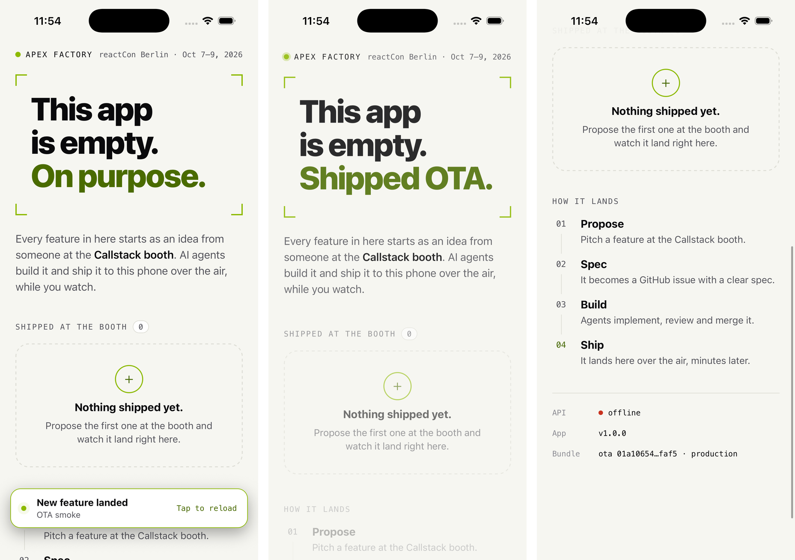
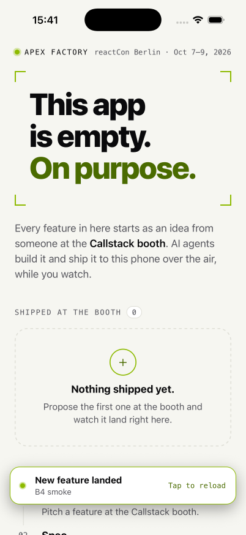

# OTA runbook (booth laptop)

How a merge to `main` reaches the phones at the booth, and how to run, check
and recover the pieces on the booth laptop. Decision record:
[ADR 0003](adr/0003-ota-through-self-hosted-hot-updater.md).

## What runs where

| Piece | Runs as | Port | State |
| --- | --- | --- | --- |
| MinIO (S3 API) | Docker, `infra/docker-compose.yml` | `9000`, all interfaces (phones download here) | `infra/data/minio/` |
| MinIO console | same container | `9001`, `127.0.0.1` only | — |
| `minio-init` | one-shot container on every `up` | — | creates bucket + user |
| OTA server (`@apex/ota-server`) | host Node process | `3002`, all interfaces | `apps/ota-server/data/ota.sqlite` |
| Deploy CLI (`hot-updater deploy`) | CI runner on the laptop, from `apps/mobile` | — | — |

Flow: the runner builds the JS bundle, uploads it to MinIO (`localhost:9000`)
and registers it with the OTA server's management API (`/hot-updater/api/*`,
bearer token). A phone asks the OTA server
`GET /hot-updater/fingerprint/<platform>/<fingerprint>/<channel>/<minBundleId>/<bundleId>`;
the answer is `null` (no update) or a bundle with a presigned `fileUrl`, which
the phone downloads straight from MinIO.

The OTA server runs on the host, not in Docker: better-sqlite3 is a native
module built for macOS by `pnpm install`, migrations need the repo anyway, and
one fewer image build means one fewer thing to break on the day.

## One-time setup

```sh
pnpm install
cp infra/.env.example infra/.env
cp apps/ota-server/.env.example apps/ota-server/.env
```

Fill the secrets (never commit them; `.env` files are gitignored):

- `infra/.env`: `MINIO_ROOT_PASSWORD` and `S3_SECRET_ACCESS_KEY` —
  `openssl rand -hex 24` each.
- `apps/ota-server/.env`: `HOT_UPDATER_AUTH_TOKEN` — `openssl rand -hex 32`;
  `S3_ACCESS_KEY_ID` / `S3_SECRET_ACCESS_KEY` — the same values as in
  `infra/.env`.
- The CI runner (and `apps/mobile/.env.hotupdater` for local deploys) needs
  all seven deploy variables — see [Deploying an update](#deploying-an-update);
  the token and S3 credentials are the same values as above.

Every variable is explained in the two `.env.example` files.

## Start of every booth day

```sh
open -a Docker
until docker info >/dev/null 2>&1; do sleep 2; done

docker compose -f infra/docker-compose.yml up -d   # MinIO + bucket/user init
pnpm --filter @apex/ota-server db:migrate          # idempotent
pnpm --filter @apex/ota-server start               # Ctrl-C / SIGTERM drains and exits
```

`minio-init` must end with `bucket 'hot-updater' ready; ...`:
`docker compose -f infra/docker-compose.yml logs minio-init`.

Check, from the laptop (replace the IP, see below):

```sh
curl http://192.168.1.20:3002/hot-updater/version
# {"version":"0.36.17"}
curl http://192.168.1.20:3002/hot-updater/fingerprint/ios/0000000000000000000000000000000000000000/production/00000000-0000-0000-0000-000000000000/00000000-0000-0000-0000-000000000000
# null   (no update for an unknown fingerprint)
curl -H "Authorization: Bearer $HOT_UPDATER_AUTH_TOKEN" http://192.168.1.20:3002/hot-updater/api/bundles
# {"data":[...],"pagination":{...}}   (401 without the header)
```

Then open `http://<lan-ip>:3002/hot-updater/version` in Safari/Chrome on a
booth phone. If that does not load, no OTA update will either.

End of day: stop the server (Ctrl-C), then
`docker compose -f infra/docker-compose.yml down`. Data stays in
`infra/data/` and `apps/ota-server/data/`.

## The laptop's LAN IP

```sh
ipconfig getifaddr en0   # Wi-Fi on most Macs; try en1 if empty
```

The IP is baked into the mobile release build (below), so it must not change
during the conference: give the laptop a DHCP reservation (or static IP) on
the booth router. Use a router we control — venue Wi-Fi often isolates
clients from each other, which silently breaks phone → laptop traffic.

## How download URLs reach phones

The OTA server answers update checks with an S3 URL presigned by the server.
SigV4 signs the `Host` header, so the URL must be signed for the host the phone
will call — rewriting `localhost` to the LAN IP afterwards would fail with
`403 SignatureDoesNotMatch`. Two endpoints are therefore configured:

- `S3_ENDPOINT` — how the server itself reaches MinIO (`http://127.0.0.1:9000`).
- `S3_PUBLIC_ENDPOINT` — the origin signed into `fileUrl`.
  - `auto` (default): taken from the `Host` the device used to reach the OTA
    server, with `S3_ENDPOINT`'s scheme and port. A phone that called
    `http://192.168.1.20:3002` gets `http://192.168.1.20:9000/...`; the iOS
    simulator calling `localhost` gets `localhost`. Nothing to change when
    the IP changes — only the mobile build knows it.
  - `http://<lan-ip>:9000`: pin it when devices reach the OTA server through a
    proxy or another host than MinIO.

The bucket stays private (no anonymous reads); presigned URLs are valid for
one hour, so a phone with a badly wrong clock gets `403`.

## Mobile release builds

hot-updater does not run in Expo Go or a debug build — the booth phones run a
**release** build. How to build one for the simulator and for an Android
device is in [apps/mobile/README.md](../../apps/mobile/README.md#release-builds-and-over-the-air-updates).
What the app does (all in `apps/mobile`, configured through `app.json`; `ios/`
and `android/` are generated):

- `["@hot-updater/react-native", { "channel": "production" }]` in the Expo
  plugins: at prebuild it patches `AppDelegate`/`MainApplication` to load
  `HotUpdater.bundleURL()` in release, and writes `HOT_UPDATER_CHANNEL` and
  `HOT_UPDATER_FINGERPRINT_HASH` into `Info.plist` / `AndroidManifest.xml`
  meta-data. The channel must match `deploy -c`.
- `src/lib/ota.ts` calls `HotUpdater.init({ baseURL })` once (configures the
  client and reports each healthy launch, which arms the native crash
  rollback). `baseURL` is `EXPO_PUBLIC_OTA_URL`, default
  `http://localhost:3002/hot-updater`.
- `src/lib/use-ota-update.ts` + `src/components/update-banner.tsx`: our own
  check loop instead of `HotUpdater.wrap`'s automatic flow — on start, on
  every return to the foreground and every 30 s. A new bundle downloads in the
  background; the banner "New feature landed — tap to reload" shows the deploy
  message (the merge commit subject); tapping reloads. A staged bundle also
  applies on the next cold start. A force update (`deploy -f`) or a
  server-side rollback (bundle disabled) reloads at once.
  *Why a banner, not auto-reload:* a visitor may be mid-tap or mid-scroll when
  the merge lands — the banner never yanks the screen away, it makes "your
  feature just arrived" a visible moment the facilitator can narrate, and a
  missed tap costs nothing (next cold start applies it). Polling, not push:
  nothing to keep alive on the laptop, and 30 s is well inside the "minutes
  later" the demo promises.
- `src/components/update-info.tsx`: the status footer's **Bundle** row,
  `embedded · production` or `ota 0199b111…7777 · production`.
- appduct (agent shortcuts, [DEVICES.md](DEVICES.md)) is **in the booth
  binary and in every OTA bundle**: `["@appduct/react-native", { "trust":
  "link", "allowPrivateLanOnly": true }]` in the plugins, its native module
  linked in Release because every build runs with `APPDUCT_ENABLED=1`. The
  `ota_check_now` tool runs the check loop immediately and `ota.update_staged`
  is posted when a bundle lands — what an agent uses instead of waiting 30 s.
  Rozenite (debugging) is dev-only: no Rozenite code is in a release or OTA
  bundle.
- Plain HTTP to the laptop: iOS `NSAppTransportSecurity.NSAllowsLocalNetworking`
  (the narrowest exception; verified on the simulator against the LAN IP — no
  `NSAllowsArbitraryLoads`) and `NSLocalNetworkUsageDescription` — accept the
  "find devices on your local network" prompt on each phone. Android:
  `expo-build-properties` → `usesCleartextTraffic: true`.

### Fingerprints: how a bundle finds its binary

Nothing registers a binary with the server. The pieces:

1. At prebuild (any `expo prebuild` / `expo run:*`), the config plugin
   computes the fingerprint per platform and **embeds** it in the binary
   (`HOT_UPDATER_FINGERPRINT_HASH`) and **writes `apps/mobile/fingerprint.json`**.
   That committed file is the record of "the binary on the booth phones".
2. `ota:deploy` recomputes the fingerprint from the checkout and compares it
   with `fingerprint.json`. Different → it stops before building
   (`Fingerprint mismatch.`) and exits 1. Same → the bundle is stored in the
   server's database tagged with that hash.
3. A phone asks `GET /hot-updater/fingerprint/<platform>/<its embedded hash>/<channel>/<minBundleId>/<bundleId>/<cohort>`;
   the server only answers with bundles carrying that exact hash.

What the fingerprint covers: native sources of every autolinked module (so
adding, removing or upgrading a native dependency — devDependencies of the
app are autolinked too), React Native's autolinking config, and — because
`hot-updater.config.ts` adds it as an extra source — `app.json`. hot-updater
on its own skips the Expo config entirely; with CNG that would let a plugin or
`Info.plist` change ship over the air to a binary that lacks it. Any
`app.json` edit therefore needs a native build, matching delivery rule 17.

**One build profile: `APPDUCT_ENABLED=1`.** The variable decides whether
appduct's pod is linked in Release, which changes React Native's autolinking
config and so the **iOS** fingerprint (`e69a1971…` with it, `ac6dc5c2…`
without it, same code; Android is unaffected). The booth binary, every
fingerprint check and every deploy must agree, so: the package scripts
(`ios`, `android`, `prebuild`, `export:check`, `ota:fingerprint`,
`ota:deploy`) set it; `scripts/hot-updater.mjs` defaults it;
`.github/workflows/ota-publish.yml` and `scripts/ci/ota-deploy.sh` set it
too; and `hot-updater.config.ts` — loaded by `expo prebuild` and by every
hot-updater command — throws unless it is `1`. A raw `expo run:ios` without
it fails at prebuild instead of building a binary with another fingerprint.
Check a built binary: `pnpm exec appduct doctor <App.app|app.apk>
--assert-present`. Verified: the presence or absence of a generated `ios/`
directory does not change the fingerprint, so CI's fresh checkout matches.

Regenerate `fingerprint.json` only together with a new binary: build it
(`APPDUCT_ENABLED=1 expo run:ios|android --configuration/--variant Release`,
or `pnpm --filter @apex/mobile prebuild`), commit the file with the native
change, and install the new binary on every booth phone. Never run
`hot-updater fingerprint create` just to make a deploy pass — that ships
bundles to a fingerprint no phone has. Check without changing anything:
`pnpm --filter @apex/mobile run ota:fingerprint` (exit 1 on mismatch).

## Deploying an update

The CLI config is `apps/mobile/hot-updater.config.ts` (Expo build plugin, the
same `s3Storage` bucket as the server, `standaloneRepository` with the bearer
header, `updateStrategy: "fingerprint"`). It reads everything from the
environment — CI sets real env; locally put them in `apps/mobile/.env.hotupdater`
(gitignored; real env wins):

| Variable | Example | Needed by |
| --- | --- | --- |
| `HOT_UPDATER_SERVER_URL` | `http://localhost:3002/hot-updater` | deploy, console, bundle |
| `HOT_UPDATER_AUTH_TOKEN` | = `apps/ota-server/.env` | deploy, console, bundle |
| `S3_ENDPOINT` | `http://127.0.0.1:9000` | deploy, console, bundle |
| `S3_REGION` | `us-east-1` | deploy, console, bundle |
| `S3_BUCKET` | `hot-updater` | deploy, console, bundle |
| `S3_ACCESS_KEY_ID` | `apex-ota` | deploy, console, bundle |
| `S3_SECRET_ACCESS_KEY` | = `infra/.env` | deploy, console, bundle |
| `EXPO_PUBLIC_OTA_URL` | `http://192.168.1.20:3002/hot-updater` | deploy |
| `EXPO_PUBLIC_API_URL` | `http://192.168.1.20:3001` | deploy |

The two `EXPO_PUBLIC_*` values are inlined into the JS bundle, and an OTA
bundle *replaces* the binary's JS: they must be exactly what the installed
binary was built with, or the phone would talk to `localhost` after the update
and never receive another one. `deploy` refuses to build without them.
`expo prebuild` and `ota:fingerprint` need none of these variables.

From the repo root (what CI runs; `--` before the options is optional):

```sh
pnpm --filter @apex/mobile run ota:deploy -p ios -c production -m "<merge commit subject>"
pnpm --filter @apex/mobile run ota:deploy -p android -c production -m "<merge commit subject>"
```

Non-interactive (no `-i`); omitting `-p` deploys iOS then Android. Exit code
0 = registered, non-zero = nothing changed on the channel. Success ends with:

```
◇  Fingerprinting (ios)
◆  Fingerprint(ios): b922ef0bdb632fa50804a3421b08cd03f768aef8
...
◆  ✅ Upload Complete (s3Storage) • 100%
◆  ✅ Update Complete (standalone-repository)
└  🚀 Deployment Successful (01a10654-1c9f-76e3-9511-a4bd46dbfaf5)
```

Native change (here an `Info.plist` key added in `app.json`), exit 1, before
anything is built or uploaded:

```
◇  Fingerprinting (ios)
■  Fingerprint mismatch. 'hot-updater fingerprint create' to update fingerprint.json
●  iOS Fingerprint Changes:
●    Changed: app.json

ota: the native fingerprint does not match fingerprint.json — this change needs a native build.
It cannot ship over the air: build and install a new binary (which rewrites fingerprint.json) and commit fingerprint.json with the change.
```

The first lines are hot-updater's; the `ota:` line is added by
`apps/mobile/scripts/hot-updater.mjs` whenever hot-updater reports a
fingerprint problem (`Fingerprint mismatch`, `Fingerprint.json not found`,
`Fingerprint hash not found`). Ignore hot-updater's "fingerprint create" hint
in CI. Missing variables fail with
`hot-updater: missing environment variable(s): <names>.`

Phones pick up a normal update within 30 s (banner) or on the next cold start;
`-f` (force update) reloads them as soon as the download finishes.

## Rollback

From `apps/mobile` on the laptop (needs the variables above, minus
`EXPO_PUBLIC_*`):

```sh
node scripts/hot-updater.mjs console                  # http://localhost:1422
node scripts/hot-updater.mjs bundle list -p ios
node scripts/hot-updater.mjs bundle disable <bundle-id> -y
```

Disabling a bundle makes the server answer phones running it with a forced
`ROLLBACK` to the previous enabled bundle (or the embedded one). Verified on
the simulator: within one 30 s check the app reloaded from the disabled OTA
bundle back to `embedded · production`, no tap needed.

### Smoke test record (4 Oct 2026, temporary dev Mac)



Release simulator build (iPhone 17 Pro, iOS 26.5, fingerprint
`b922ef0b…`) pointed at the LAN IP; a temporary hero text change
("Shipped OTA.", never committed) deployed with
`pnpm --filter @apex/mobile run ota:deploy -p ios -c production -m "OTA smoke"`;
the banner appeared within one 30 s check; tap → new text, footer
`ota 01a10654…faf5 · production`. The OTA bundle carried the LAN URLs
(checked in `apps/mobile/dist/index.ios.bundle`), so the phone keeps talking
to the laptop after the update.

Afterwards every test bundle on `production` was **disabled** (not
superseded by a redeploy of the reverted code): `01a10654…` and `01a10646…`
(OTA smoke, the second on an earlier binary) and `01a10649…` ("native change
probe" — deployed by mistake before `app.json` was part of the fingerprint,
which is how that gap was found). With nothing enabled, the booth binaries run
their embedded JS until the first real merge; the simulator rolled back to
`embedded · production` on its own within 30 s.

### Smoke test record: the appduct binary (4 Oct 2026, temporary dev Mac)

Release simulator build with appduct linked (`APPDUCT_ENABLED=1`, LAN URLs,
fingerprint `e69a1971…` = `fingerprint.json`; `appduct doctor --assert-present`
holds), paired with appduct. A temporary hero text change ("Shipped OTA.",
never committed) deployed with
`pnpm --filter @apex/mobile run ota:deploy -p ios -c production -m "B4 smoke"`
→ bundle `01a10725…be68`. The 30 s loop had already staged it when
`ota_check_now` ran (`already_staged`); `ota.update_staged` arrived as an
appduct event; tapping the banner (agent-device) reloaded into the bundle and
`app_info` reported `embedded: false`, bundle `01a10725…` — the appduct
session survived the reload, and the tools kept working from the OTA bundle.
Then the bundle was **disabled** (`bundle disable … -y`); the next
`ota_check_now` triggered the forced rollback and the app was back on
`embedded · production` within seconds. The rollback reloaded before the tool
could answer, so forced reloads now wait 250 ms (`FORCED_RELOAD_DELAY_MS`).



## Troubleshooting

| Symptom | Likely cause / fix |
| --- | --- |
| `docker compose up` cannot pull `minio/minio` | MinIO's images are gone from Docker Hub and gated on quay.io (Sept 2026). The compose file uses `pgsty/minio` / `pgsty/mc`; override with `MINIO_IMAGE` / `MC_IMAGE`. |
| `docker pull` hangs forever | The Docker credential helper (`docker-credential-desktop`) is stuck, e.g. on a keychain prompt. Sign in to Docker Desktop or unlock the keychain; for anonymous pulls, point `DOCKER_CONFIG` at a config without `credsStore`. |
| OTA server exits with `Invalid OTA server environment` | A variable is missing or malformed; the message names it. |
| `500` + `schema is not initialized` | Run `pnpm --filter @apex/ota-server db:migrate`. |
| Phone cannot open `http://<ip>:3002/...` | Wrong IP; laptop and phone on different networks; Wi-Fi client isolation; macOS firewall blocking `node` (System Settings → Network → Firewall). |
| Update check works, download fails | `fileUrl` host unreachable from the phone (check `S3_PUBLIC_ENDPOINT`; port 9000 blocked by the firewall for Docker); `403` = signed for another host or phone clock off. |
| `deploy` fails with `401` | `HOT_UPDATER_AUTH_TOKEN` on the runner differs from the server's. |
| `deploy` fails with `Access Denied` from S3 | `S3_ACCESS_KEY_ID` / `S3_SECRET_ACCESS_KEY` differ from `infra/.env`; rerun `docker compose -f infra/docker-compose.yml up -d` after changing them. |
| `deploy` fails with `Fingerprint mismatch.` | The checkout's native side (a native dependency, `app.json`) differs from `fingerprint.json`: the merge needs a native build. See [Fingerprints](#fingerprints-how-a-bundle-finds-its-binary). |
| `deploy` fails with `missing environment variable(s)` | Set the named variables (CI secrets/env, or `apps/mobile/.env.hotupdater`). |
| A phone took one update, then never another | The bundle was deployed with `EXPO_PUBLIC_OTA_URL` different from the binary's (e.g. unset → `localhost`). Fix the runner's env and redeploy. A phone already running that bundle asks the wrong server and cannot be reached any more: reinstall the binary. |
| No banner, server log shows no `/fingerprint/...` requests | Debug build (hot-updater is off in dev), wrong `EXPO_PUBLIC_OTA_URL` baked in, or the iOS local-network prompt was denied (Settings → Privacy → Local Network). |
| Requests arrive but the answer is always `null` | The binary's fingerprint has no enabled bundle: compare `HOT_UPDATER_FINGERPRINT_HASH` in the request path with `fingerprint.json` / `ota:fingerprint`. |
| `EADDRINUSE` on 3002 / 9000 | Another process holds the port: `lsof -nP -iTCP:3002 -sTCP:LISTEN`. |

Full reset (deletes every deployed bundle): stop everything, remove
`infra/data/` and `apps/ota-server/data/`, then start again from the top.

## Machine setup log

Every machine-level step taken on the **temporary dev Mac** (4 Oct 2026)
while bootstrapping the OTA client, in order, so the booth laptop can be set
up from docs (to become `docs/BOOTSTRAP.md`). Secrets are never written here.

Machine as found: macOS 26.5 (Apple silicon), Node 22.22.2, pnpm 11.22.0
(`packageManager`), Docker Desktop running, Xcode 26.6 with an iPhone 17 Pro
/ iOS 26.5 simulator booted, CocoaPods from Homebrew Ruby
(`/opt/homebrew/lib/ruby/gems/3.1.0/bin/pod`), JDK 17 (Zulu) as default
`java`, Android SDK at `~/Library/Android/sdk` (platform 36, build-tools
36.0.0, NDK 27.1.12297006, AVDs `Pixel_8`) but **`ANDROID_HOME` not set**.

1. `pnpm install` in the checkout (worktree) — nothing global installed.
2. Infra state lives in the **main checkout** (`~/Projects/apex-software-factory`),
   not in an agent worktree, so it survives worktree cleanup and every
   checkout's CI/deploy talks to the same instance:
   - `infra/.env` and `apps/ota-server/.env` created from the `.env.example`
     files; `MINIO_ROOT_PASSWORD`, `S3_SECRET_ACCESS_KEY` (shared by both
     files) = 24 random bytes hex, `HOT_UPDATER_AUTH_TOKEN` = 32 random bytes
     hex (equivalent of `openssl rand -hex 24|32`), files mode 600.
   - `docker compose -f infra/docker-compose.yml up -d` — pulled
     `pgsty/minio:RELEASE.2026-08-04T00-00-00Z` and
     `pgsty/mc:RELEASE.2026-09-16T00-00-00Z` without credential-helper
     trouble; `minio-init` printed `bucket 'hot-updater' ready; user
     'apex-ota' has policy apex-ota`. Container `apex-ota-minio-1`,
     `restart: unless-stopped`, data in `infra/data/minio/`.
   - `pnpm --filter @apex/ota-server db:migrate` → `Migrated to 0.31.0`
     (`apps/ota-server/data/ota.sqlite`).
   - OTA server started detached from `apps/ota-server`:
     `nohup node src/main.ts >> data/ota-server.log 2>&1 &` (same as
     `pnpm start` without the pnpm parent). Listens on `*:3002`; stop with
     `kill <pid>` (SIGTERM drains). It does **not** restart on reboot — on the
     booth laptop make it a launchd agent or start it each morning.
3. LAN IP of this Mac: `ipconfig getifaddr en0` → `192.168.1.61` (DHCP, not
   reserved — the booth laptop needs a reservation, see above).
4. `apps/mobile/.env.hotupdater` (gitignored) for local deploys: the seven
   deploy variables (server URL `http://localhost:3002/hot-updater`, token and
   S3 values copied from `apps/ota-server/.env`) plus
   `EXPO_PUBLIC_OTA_URL=http://192.168.1.61:3002/hot-updater` and
   `EXPO_PUBLIC_API_URL=http://192.168.1.61:3001`.
5. iOS release build for the simulator, through the lane lock:
   `LANG=en_US.UTF-8 LC_ALL=en_US.UTF-8 EXPO_PUBLIC_OTA_URL=… EXPO_PUBLIC_API_URL=… APEX_SIM_DEVICE="iPhone 17 Pro" .agents/scripts/sim-lane.sh build`
   (= `pnpm --filter ./apps/mobile exec expo run:ios --configuration Release --no-bundler`).
   First build ≈ 6 min (pods + compile), log in `$TMPDIR/apex-sim-lane-build-*.log`.
   Without `LANG`, CocoaPods warns about the encoding (and may fail). Expo's
   "Installing CocoaPods..." step is `pod install`, not a CocoaPods install.
   Before it: `pnpm exec expo prebuild --clean --no-install` (from
   `apps/mobile`) so `fingerprint.json` and `Info.plist` are regenerated.
6. Simulator smoke test and rollback — see [Smoke test record](#smoke-test-record-4-oct-2026-temporary-dev-mac).
   The first iOS local-network prompt does not appear on the simulator; on a
   phone it does.
7. Android release APK (no device attached, emulator not started):
   `cd apps/mobile/android && ANDROID_HOME=$HOME/Library/Android/sdk JAVA_HOME=/Library/Java/JavaVirtualMachines/zulu-17.jdk/Contents/Home EXPO_PUBLIC_OTA_URL=… EXPO_PUBLIC_API_URL=… ./gradlew assembleRelease`
   (first run downloads the Gradle distribution and Maven dependencies).
   `BUILD SUCCESSFUL in 8m 42s` (first run, all four ABIs) →
   `android/app/build/outputs/apk/release/app-release.apk` (≈ 100 MB,
   debug-keystore signed). `aapt dump xmltree` shows
   `usesCleartextTraffic=true`, `com.hotupdater.CHANNEL=production` and
   `com.hotupdater.FINGERPRINT_HASH=8bdbddf8…` (= `fingerprint.json`
   `android.hash`). Not installed or OTA-tested on a device/emulator yet —
   on the booth laptop: `adb install -r app-release.apk`, then repeat the
   smoke test with `-p android`.

Left running for the CI agent and the demo: MinIO container
`apex-ota-minio-1` (ports 9000 on all interfaces, 9001 on 127.0.0.1) and the
OTA server (`node src/main.ts`, port 3002, log
`apps/ota-server/data/ota-server.log` in the main checkout). The simulator has
the release build installed, running its embedded bundle.

### Agent tooling (appduct binary), same Mac, same day

Device-side steps (agent-device, appduct daemon, Metro, the debug build) are
logged in [DEVICES.md](DEVICES.md#machine-setup-log). OTA-side:

8. `apps/mobile/.env.hotupdater` recreated in the agent worktree (the earlier
   one lived in a removed worktree) by a script that copies the token and S3
   values from the main checkout's `apps/ota-server/.env` without printing
   them, plus `EXPO_PUBLIC_*` for `192.168.1.61`; mode 600, gitignored.
9. iOS Release build with appduct over the existing release install:
   `LANG=en_US.UTF-8 APPDUCT_ENABLED=1 EXPO_PUBLIC_OTA_URL=http://192.168.1.61:3002/hot-updater EXPO_PUBLIC_API_URL=http://192.168.1.61:3001 pnpm exec expo run:ios --configuration Release --no-bundler --device <UDID>`
   (≈ 8 min, pods already installed). `fingerprint.json` regenerated by the
   prebuild: iOS `e69a1971…`, Android `c273005b…`.
10. Smoke deploy `01a10725…` ("B4 smoke") to `production`, then disabled (see
    the record above). Bundles on `production` afterwards: `01a10665…` (the
    #12 merge, for the old `b922ef0b…` binary) enabled; every smoke bundle
    disabled.
11. `~/.appduct/config.json` created with
    `{"policy":{"default":"allow","destructive":"deny"}}` and the appduct
    daemon restarted (`appduct daemon stop`); `reload_app` now answers
    `policy_denied` (exit 77).

